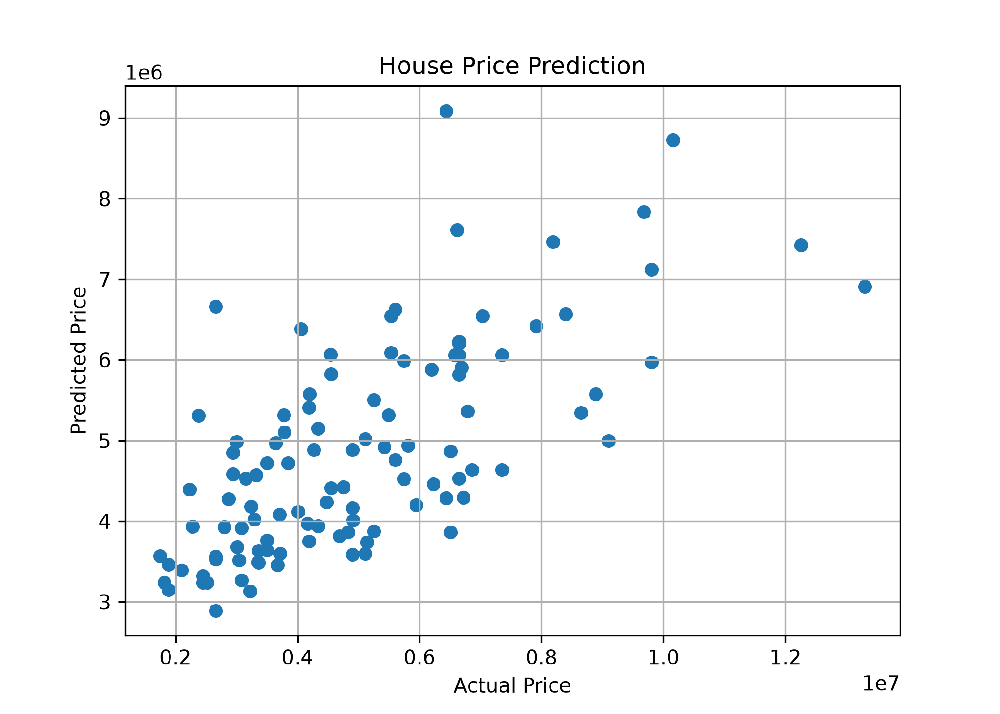

#  House Price Prediction Using Linear Regression

<p align="center">
  <strong>SkillCraft Technology Internship · Task 1</strong>
</p>

<p align="center">
  A Machine Learning project to predict house prices using Linear Regression.
</p>

---

##  Project Overview

This project focuses on predicting house prices using a **Linear Regression** model. The model uses three key features to generate predictions:

-  Area
-  Number of Bedrooms
-  Number of Bathrooms

##  Technologies Used

| Technology | Purpose |
|---|---|
| Python | Programming language |
| Pandas | Data handling and analysis |
| Matplotlib | Data visualization |
| Scikit-learn | Machine Learning model |

##  Dataset

**Dataset Name:** Housing Price Dataset

Location: `data/Housing.csv`

##  Workflow

The project follows these steps:

1. **Data Loading** — Loaded the housing dataset.
2. **Feature Selection** — Selected the required input features.
3. **Data Splitting** — Split the dataset into training and testing data.
4. **Model Training** — Trained a Linear Regression model.
5. **Model Evaluation** — Evaluated model performance using standard metrics.
6. **Price Prediction** — Predicted house prices using the trained model.
7. **Visualization** — Created an Actual Price vs Predicted Price graph.

##  Model Evaluation

The model performance is measured using the following metrics:

- **Mean Absolute Error (MAE)**
- **Mean Squared Error (MSE)**
- **R² Score**

##  Project Output

### House Price Prediction Graph

The following graph visualizes the actual house prices against the predicted house prices.

<p align="center">
  
</p>

##  Project Structure

```text
SCT_ML_1/
│
├── data/
│   └── Housing.csv
│
├── images/
│   └── house_prediction.png
│
├── main.py
├── README.md
├── requirements.txt
└── .gitignore
```

---

<p align="center">
  <strong>SkillCraft Technology Internship · Task 1</strong>
  <br>
  Machine Learning | Linear Regression | House Price Prediction
</p>
